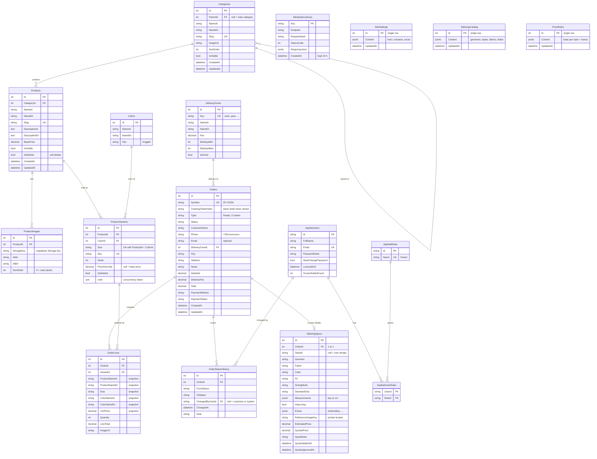

# Zamzam Fashion — Database

PostgreSQL 17 (Supabase) · EF Core · schema `zamzam`. Readable version: [database-erd.pdf](database-erd.pdf) (overview + one page per group) or the images in [database/](database/). GitHub draws the diagram below automatically.

Every table that inherits `Entity` also has `CreatedAt` and `UpdatedAt` (set automatically when saving).

